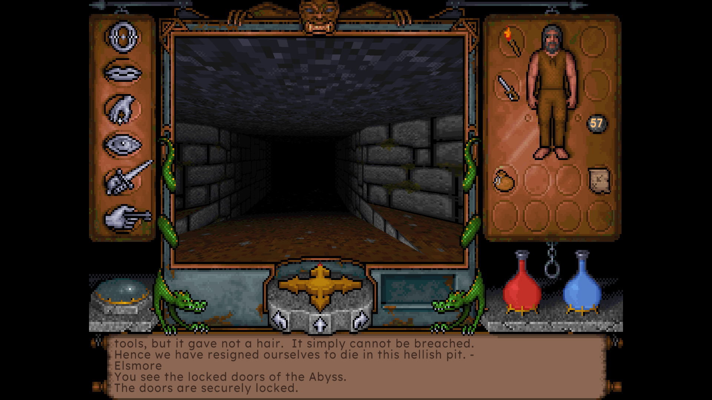
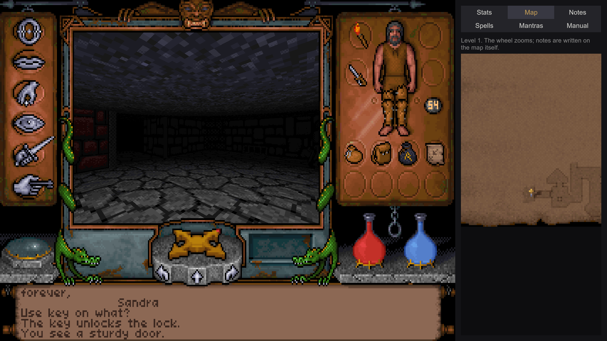
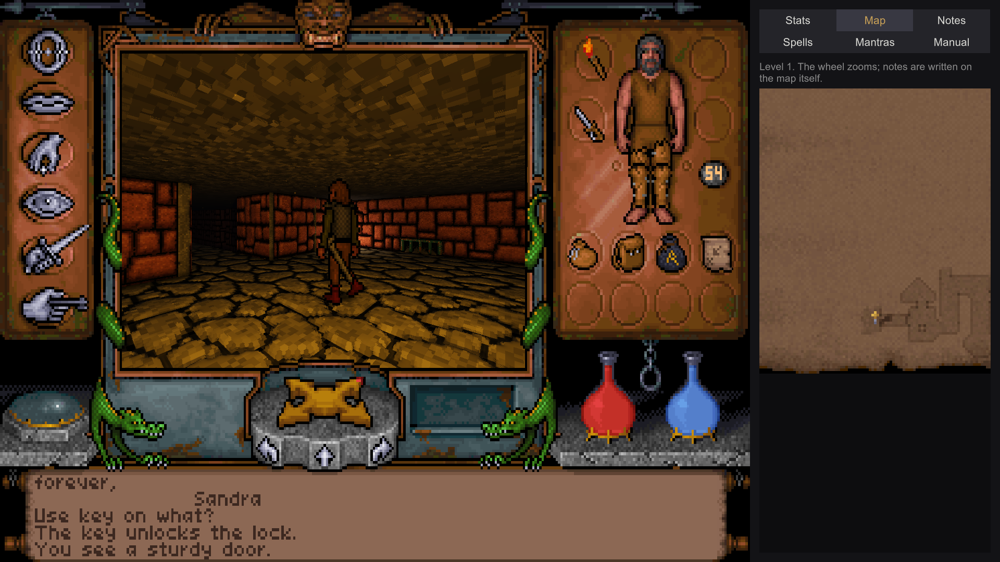
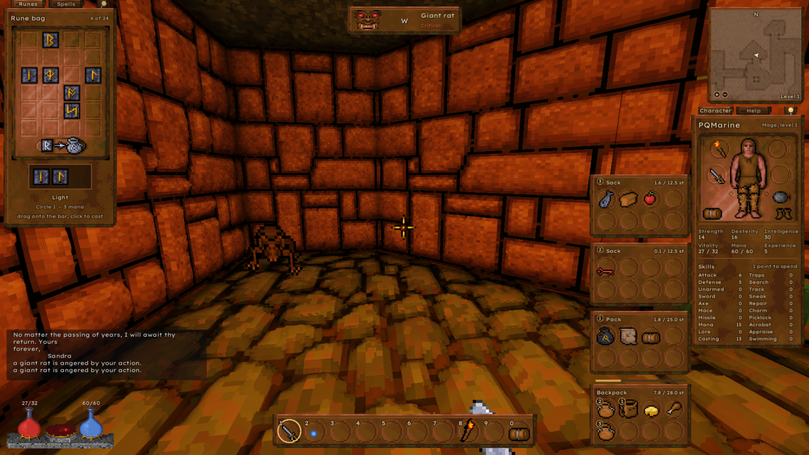
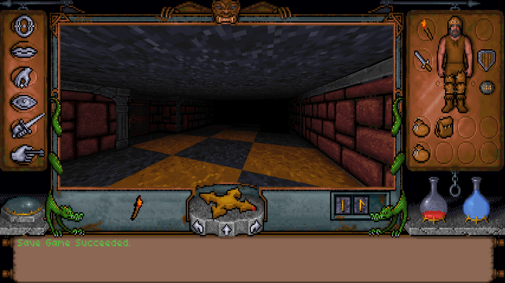
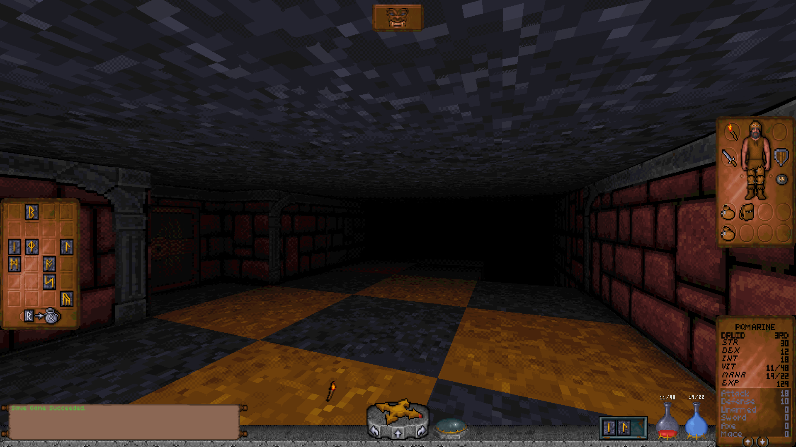

# Underworld Revisited

An open-source reimplementation of **Ultima Underworld: The Stygian Abyss** (1992) in Unity,
built on the original game data. The goal is full gameplay parity with the original, plus an
optional modern render mode. Ultima Underworld II can be tried as an early preview since 0.13.0:
its menus, its character creation, its saves and a walk through Britannia with its game screen -
not yet its rules, conversations or map ([Docs/UW2-PLAN.md](Docs/UW2-PLAN.md)).

**You need your own copy of Ultima Underworld - the GOG.com version** ("Ultima Underworld
1+2"); other releases are not supported (see [Requirements](#requirements)). This repository
contains no game data: no graphics, sounds, texts, maps or executables of the original.
Everything is read at runtime from your installation. The only exception are the screenshots,
which show the original's artwork.

**To play, download the latest release** for Windows or Linux from the
[Releases page](https://github.com/PQMarine/UnderworldRevisited/releases) - see
[Installation](#installation).

This project is not affiliated with or endorsed by the owners of the Ultima Underworld
rights. Ultima and Ultima Underworld are trademarks of their respective owners. Underworld
Revisited is a free, non-commercial fan project: it is not sold, and no donations are accepted.

**Contents:** [Screenshots](#screenshots) - [Features](#features) - [Requirements](#requirements) -
[Installation](#installation) - [Controls](#controls) - [For developers](#for-developers) -
[How this was made](#how-this-was-made) - [License](#license)

More: [Controls](Docs/CONTROLS.md) - [All screenshots](Docs/SCREENSHOTS.md) -
[Building](Docs/BUILDING.md) - [Translating](Docs/TRANSLATING.md) - [Roadmap](ROADMAP.md) - [Third-party notices](THIRD_PARTY_NOTICES.md)

## Screenshots



*The classic interface at 4:3, Palette mode, with the modern font.*

| Palette mode | Remastered mode |
|---|---|
|  |  |
| *Light computed like the original, the help window beside the view with a live map.* | *The same spot lit by URP, with relief and glow.* |



*The modern control scheme: the rune panel at the left, the character panel and the bags at
the right, the action bar below.*

| Classic Wide | Classic Modular |
|---|---|
|  |  |
| *The modern scheme in the original's frame, widened to a wide screen.* | *The original's pieces as parts of their own over the whole view.* |

More in [the screenshot gallery](Docs/SCREENSHOTS.md): the world at the original's resolution,
the Palette effects, both fonts, the layout editor, conversations and trading. The screenshots
show the artwork of the original game, which belongs to the owners of the Ultima Underworld
rights. It is shown for illustration only and is not covered by this project's licence.

## Features

Built and largely confirmed against the original, and played through from character creation
to the end sequence. Open points are listed in [ROADMAP.md](ROADMAP.md).

**The game**

- The nine dungeon levels with their objects, doors, locks, traps and triggers; the 3D models
  (barrel, chest, chair, shrine, bridge, portcullis ...) read from `UW.EXE`
- Combat with the original's tables, magic with runes, and the creatures with their goals,
  attitudes and group alarm
- Conversations, running the original conversation bytecode, including trading
- Character creation, inventory and paperdoll, automap, sleeping, hunger and fatigue, the
  endgame with talismans and the void
- Save games compatible with the original's, in `UNDEROM1\SAVE1` to `SAVE4`
- Intro, dreams and the end sequence from the original's cutscene files, with speech
- The motion of the player, the creatures and thrown things as the original's own code, run
  call by call as the original did or as a precise, frame-rate independent computation of the
  same rules; or, for the player, Modern: sliding along walls, the view staying where it looks,
  with the original's jumps, ledges and falls ([Motion](Docs/CONTROLS.md#motion))

**Graphics**

- **Palette** mode computes light like the original through SHADES.DAT and LIGHT.DAT;
  **Remastered** lights with URP and adds relief, specular highlights, glow, shadows and torch
  lights - each switchable on its own
- Effects of the port's own for the Palette mode that keep every pixel a colour of the
  original's palette: ambient occlusion, grime along the walls, wall depth with its shadow,
  darker joints, ground shadows, glowing lava and flames, and light sources lighting their
  surroundings by the original's light table. Off by default, with the presets Subtle and Full
- The world at the original's resolution or a multiple of it up to 4x, with hard pixels while
  the interface stays sharp
- The classic interface at the original's 4:3, or widened to a wide screen with the frame's
  stone grown anew instead of stretched; a slider for the view angle

**Sound and music**

- AdLib music and sound effects through an OPL2 emulation (a C# port of the YM3812 core of
  Aaron Giles' [ymfm](https://github.com/aaronsgiles/ymfm))
- The music's MT-32 version on **General MIDI**, with a soundfont that comes with the game
- The same music on the **Roland MT-32** itself, emulated by [Munt](https://github.com/munt/munt) -
  with the ROMs of a real unit, which you supply (see [Installation](#installation))
- **Recordings** of the music you supply, one file per piece, in place of the synthesizer

**Controls and interface**

- Two control schemes: the original's mouse-pointer steering, and a modern scheme of the
  port's own with free mouse look, WASD, an action bar, bags, a character panel and a rune
  panel built from the original's artwork, and a layout editor to move and size every part
- Interface presets for the modern scheme: Modern; Classic Modular, the original's own pieces
  (compass, message scroll, power gem, flasks, rune tablet, stats panel, character page with
  the original inventory) as parts of their own; Classic Wide, the original's frame widened to
  the screen; or a layout of one's own, which can start from any preset
- A gamepad in both schemes, with a pointer on the stick for every window, a letter grid for
  typing, glyphs for Xbox, PlayStation, Nintendo or the Steam Deck, and every button rebindable
- A help window beside the view: stats with the hidden values, a live map, notes kept with the
  save game, spells, mantras and the game's manual
- A modern readable font, and dealing the attribute points at character creation yourself
  instead of rolling them - each of these additions optional
- Languages: the port's texts in English or German, chosen in the Game window and switched at
  once; the game's own texts can be translated by language files ([Translating](Docs/TRANSLATING.md))
- Two looks for the game's own windows: Stone, in the colours of the game's icon (the default),
  and the plain one
- The rule set: an optional `rules.json` in the `UW1` folder beside the settings changes the game's numbers -
  combat, magic, creatures, motion, trade and more, and the original's quirks as switches.
  `Docs/rules-template.jsonc` in the release package (or `uwdump rules-template`) lists every
  key with its default and meaning; without the file the game plays as the original

## Requirements

- **Windows** 10 or newer (64-bit) with a DirectX 11 graphics card. It is the system the port
  is developed and tested on.
- **Linux** (64-bit, x86-64, Vulkan or OpenGL 4): part of every release since 0.3.0, tested
  in a Kubuntu virtual machine and far less than the Windows version. macOS is untried.
  Reports from other systems are welcome.
- **Ultima Underworld 1 from GOG.com** ("Ultima Underworld 1+2"). Only this version is
  supported: some data (3D models, their colours) is read directly from the game's executable
  at build-specific offsets, verified against the GOG `UW.EXE` (547,248 bytes). Other
  releases (original floppy, CD, other stores) may differ and are not supported.
- Unity **6000.6.0f1** (Unity 6), Universal Render Pipeline - only to build it yourself.

## Installation

First install Ultima Underworld from GOG.com ("Ultima Underworld 1+2"). Then:

1. Download the latest release from the
   [Releases page](https://github.com/PQMarine/UnderworldRevisited/releases):
   `UnderworldRevisited-<version>-win64.zip` for Windows or
   `UnderworldRevisited-<version>-linux64.tar.gz` for Linux.
2. Unpack it into a folder of its own.
3. Start `UR.exe` (Windows) or `UR.x86_64` (Linux). Should Linux refuse to run it, the
   executable bit got lost on the way: `chmod +x UR.x86_64` in that folder, once.
4. The game looks for your GOG installation in the usual places (listed in
   [Building](Docs/BUILDING.md#building-the-game)). If it does not find it, it asks for the
   folder: choose the one that contains `game.gog`. The choice is remembered and can be
   changed later in the menu bar of the main menu (*Game > Game folder...*).

Nothing else needs to be installed; the package brings its own runtime. On the first start the
game files are extracted from `game.gog` once into a local cache; nothing is written to the
installation. Save games are read from and written to the installation's `UNDEROM1\SAVE1` to
`SAVE4`, so they can be exchanged with the original game.

**Music.** The *Sound* menu chooses what plays the music: the AdLib (as most heard it in
1992), General MIDI, or the MT-32. For the MT-32, put the control and PCM ROM of your own
Roland MT-32 or CM-32L into the folder the *Open folder* button there opens; they belong to
Roland and do not come with the game. The menu shows which ROMs were recognised.

**Music from recordings.** Under *Music from recordings* in the same window, your own recordings
of the music play in place of the device, one file per piece in the folder its *Open folder*
button opens (`UW1/Music` beside the settings). Name each file by the number of the game's piece
(`UW01.XMI` in its `SOUND` folder is `01`): `01` the introduction, `02` to `04` the levels, `05` to
`07` combat, `10` Armed, `11` Victory, `12` Death, `13` Fleeing, `15` Maps and Legends, as `.ogg`
(Ogg Vorbis) or `.wav`. A piece without a
recording plays on the device. The high-quality remake by
[Pieces of 8-bit](https://www.youtube.com/c/Piecesof8bit)
([on Nexus Mods](https://www.nexusmods.com/ultimaunderworldunity/mods/1), made for Hank Morgan's
UnderworldExporter) uses these names: the files of its `UW1music` folder can be copied in as they
are.

## Controls

Two schemes, both complete: the **original** one, where the visible mouse pointer steers the
walking as in 1992, and a **modern** one with free mouse look, WASD and an interface of its own.
**Shift+F2** switches between them at any time, and so does *Game* in the menu bar. A
**gamepad** works in both.

The help window (**Tab**) has a *Controls* tab with the keys of the scheme in force, as you
have bound them; keys, mouse buttons and gamepad buttons can be changed under *Controls* in the
menu bar at the top edge. The full tables, the gamepad layout and the motion options are in
[Docs/CONTROLS.md](Docs/CONTROLS.md).

## For developers

How to build the game yourself, pack a release, and use the engine-free layer
(`Assets/UWDataImport`, buildable with the plain .NET SDK) and its tools is described in
[Docs/BUILDING.md](Docs/BUILDING.md). Before building, the self-check tells whether your copy
of the game works with this port:

```
dotnet run --project Tools/UWSelfCheck -- "C:\GOG Games\Ultima Underworld 1"
```

## How this was made

I have been a fan of Ultima Underworld ever since it came out in 1992. In 2012 I came
across uw-formats.txt, a text file describing the game's data formats, more or less by
chance, and thought: why not give it a try? That was the start of this project, but I
never had the time or the experience to take it further. In 2026, with the help of Claude
(Anthropic's AI model, via Claude Code), I picked it up again. Since then the code has
been written by Claude; I decided what to build, tested every behaviour against the
original game and confirmed or rejected the results.

### Thanks

This project would not be where it is without **hankmorgan**'s work. His
[UWReverseEngineering](https://github.com/hankmorgan/UWReverseEngineering) project, a
disassembly of `UW.EXE` with named routines and a large guide to the game's mechanics, is
where most of the rules here were read from: the motion code, the creature AI, traps,
magic and much more. His [UnderworldGodot](https://github.com/hankmorgan/UnderworldGodot),
a recreation of both Underworld games, provided many formulas and data tables (see
[THIRD_PARTY_NOTICES.md](THIRD_PARTY_NOTICES.md)), and his earlier
[UnderworldExporter](https://github.com/hankmorgan/UnderworldExporter) showed long ago that
the game can live in Unity.

Thanks to **abedegno** for [Underworld Exhumed](https://github.com/abedegno/underworld-exhumed),
a decompilation that rebuilds `UW.EXE` byte for byte from readable source. The rules here
are checked against it, and many of them were corrected that way. Nothing of its code is
taken into this project.

Thanks to **Pieces of 8-bit** for the high-quality remake of the game's music that plays here
from recordings (see *Music from recordings* above). Their
[YouTube channel](https://www.youtube.com/c/Piecesof8bit) has high-quality remakes of many
classic game soundtracks, from the Ultima series to System Shock, Doom and other classics, and their
[mods on Nexus Mods](https://www.nexusmods.com/profile/OfficialPo8Mods/mods) bring several of
them into the games.

Thanks also to the authors of uw-formats.txt, where this project started.

The application icon (`Art/Icon/ur-icon.svg`, rendered to `Assets/UWIcon/UWRIcon.png`) was
also made with generative AI (Claude). It shows the runes uruz and raidho (U and R), drawn
after the historical Elder Futhark; nothing in it is taken from the game.

## License

Underworld Revisited is released under the MIT License, see [LICENSE](LICENSE). Parts are
derived from other projects under their own licenses, see
[THIRD_PARTY_NOTICES.md](THIRD_PARTY_NOTICES.md).
