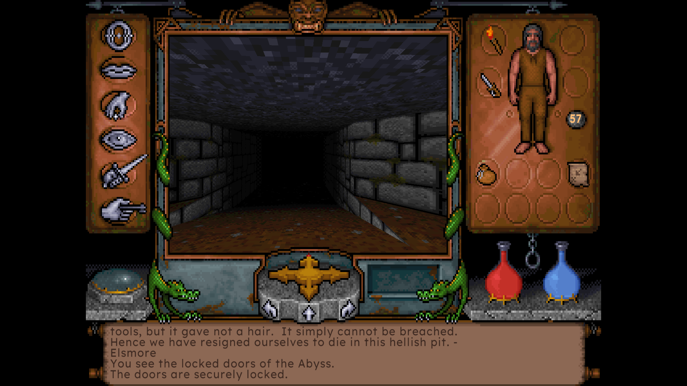
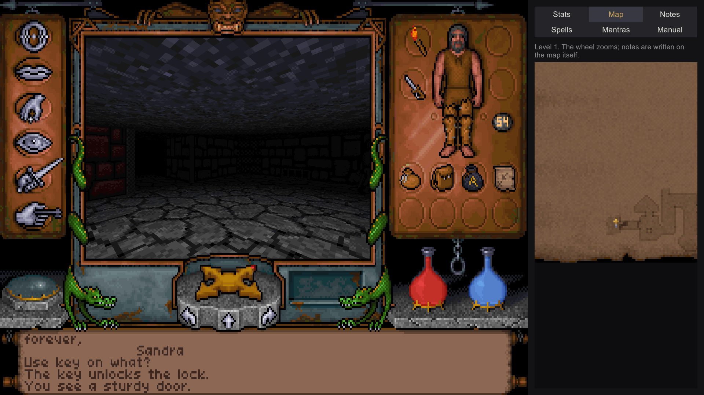
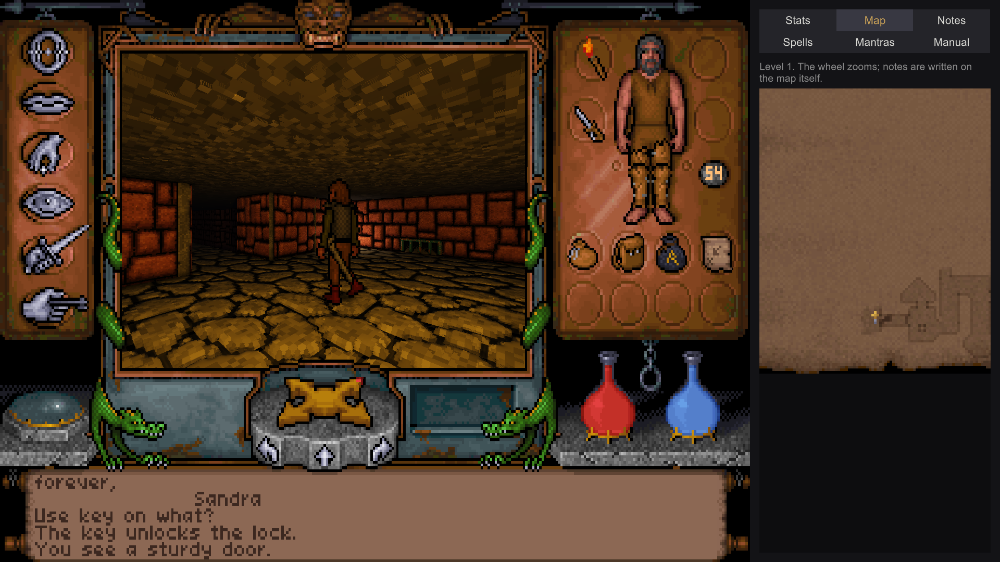
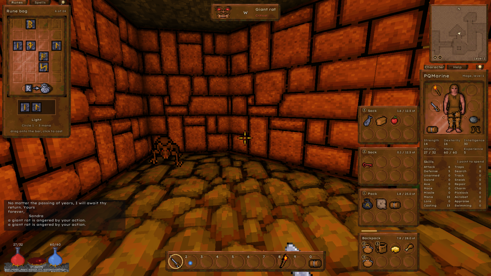
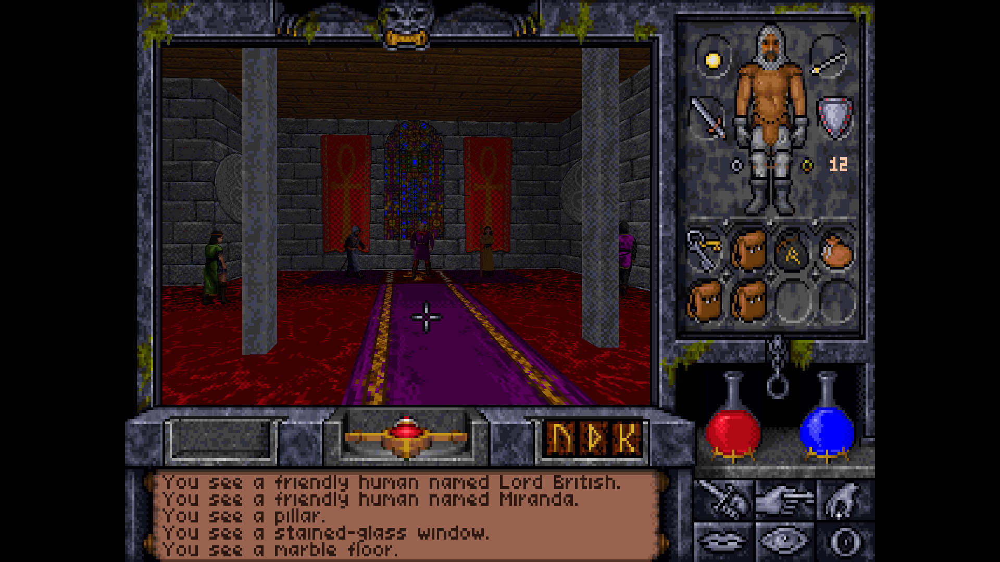
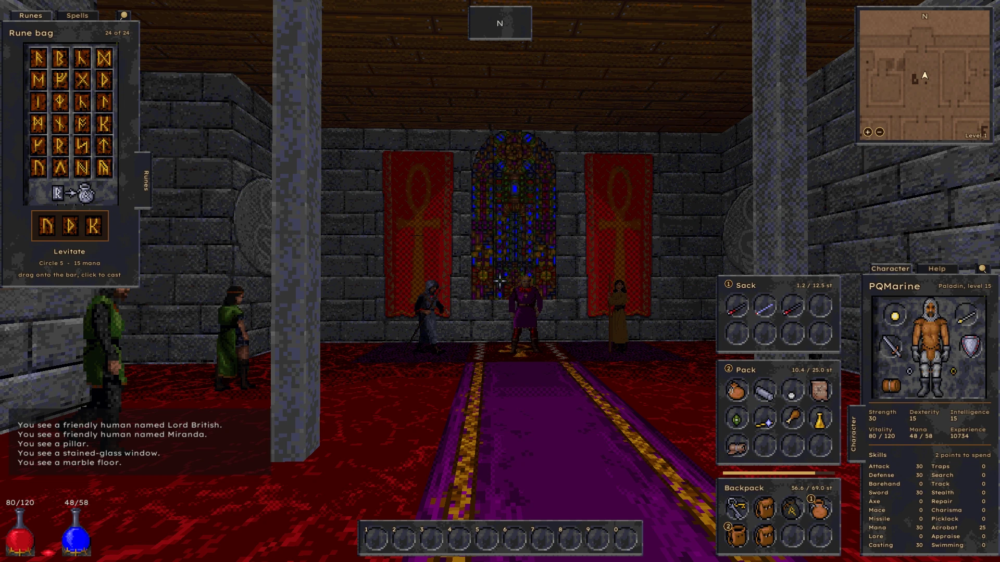

# Underworld Revisited

An open-source reimplementation of **Ultima Underworld: The Stygian Abyss** (1992) and **Ultima Underworld II:
Labyrinth of Worlds** (1993) in Unity, built on the original game data and faithful to the originals' rules.

- **Ultima Underworld I is complete**: it can be played from character creation to the end, compared step by step
  with the original, and save games work both ways.
- **Ultima Underworld II is in beta**: every rule, the music, the sound and the cutscenes are built, the whole game
  has been played through and compared with the original, and its classic interface has been checked against the
  original area by area. Save games work both ways here too.

On top of the original, everything optional and off by default: a modern render mode, a modern control scheme with
interface presets and a layout editor, a gamepad, a help window, and gameplay aids. Bugs of the originals that can
cost you the game are fixed, and can be switched back. The games can be translated
([Translating](Docs/TRANSLATING.md)).

**You need your own copy of the games - from GOG.com, Steam or the EA app**, which carry the same game files; other
releases are not supported (see [Requirements](#requirements)). Ultima Underworld II is sold on its own and is
needed only to play it. This repository contains no game data: no graphics, sounds, texts, maps or executables of
the originals. Everything is read at runtime from your installation. The only exception are the screenshots, which
show the originals' artwork.

**To play, download the latest release** for Windows or Linux from the
[Releases page](https://github.com/PQMarine/UnderworldRevisited/releases), unpack it and start it - see
[Installation](#installation). The project's website, with the graphics modes side by side and the interfaces to
compare, is at **[pqmarine.github.io](https://pqmarine.github.io/)**.

This project is not affiliated with or endorsed by the owners of the Ultima Underworld rights. Ultima and Ultima
Underworld are trademarks of their respective owners. Underworld Revisited is a free, non-commercial fan project:
it is not sold, and no donations are accepted.

**Contents:** [Screenshots](#screenshots) - [Features](#features) - [Requirements](#requirements) -
[Installation](#installation) - [Controls](#controls) - [For developers](#for-developers) -
[How this was made](#how-this-was-made) - [License](#license)

More: [Website](https://pqmarine.github.io/) - [Installing](Docs/INSTALLING.md) - [Controls](Docs/CONTROLS.md) -
[Deviations from the originals](Docs/DEVIATIONS.md) - [All screenshots](Docs/SCREENSHOTS.md) -
[Building](Docs/BUILDING.md) - [Translating](Docs/TRANSLATING.md) - [Roadmap](ROADMAP.md) -
[Third-party notices](THIRD_PARTY_NOTICES.md)

## Screenshots

**Ultima Underworld I**



*The classic interface at 4:3, Palette mode, with the modern font.*

| Palette mode | Remastered mode |
|---|---|
|  |  |
| *Light computed like the original, the help window beside the view with a live map.* | *The same spot lit by URP, with relief and glow.* |



*The modern control scheme: the rune panel at the left, the character panel and the bags at the right, the action
bar below.*

**Ultima Underworld II**

| Classic interface | Modern interface |
|---|---|
|  |  |
| *The throne room of Lord British in the second game's own screen, as in 1993.* | *The same room with the modern scheme and the first game's panels.* |

More in [the screenshot gallery](Docs/SCREENSHOTS.md): the world at the original's resolution, the Palette effects,
the interface presets, both fonts, the layout editor, conversations and trading. The screenshots show the artwork
of the original games, which belongs to the owners of the Ultima Underworld rights. It is shown for illustration
only and is not covered by this project's licence.

## Features

Both games are built against their originals - read from the decompiled and disassembled executables, checked by
playing the originals side by side, and played through from character creation to the end. What stays different
on purpose is listed in [Docs/DEVIATIONS.md](Docs/DEVIATIONS.md), open points in [ROADMAP.md](ROADMAP.md).

**Ultima Underworld I**

- The nine levels of the Stygian Abyss with their objects, doors, locks, traps and triggers, and the 3D models read
  from `UW.EXE`
- Combat with the original's tables, magic with runes, the creatures with their goals, attitudes and group alarm
- Conversations running the original conversation bytecode, trading included
- Character creation, inventory and paperdoll, automap, sleep, hunger and fatigue, and the endgame with the
  talismans and the Ethereal Void
- Intro, dreams and the end sequence from the original's cutscene files, with speech

**Ultima Underworld II**

- Castle British and the worlds reached through the blackrock gem, with their creatures, schedules, events and
  traps
- The conversations and what they change, magic and the special weapons, water, lava and ice
- The player's death and the jail, the music by the game's own rules, and the cutscenes
- Its own classic screen, inventory, panels, map and options, and the first game's modern interface drawn from
  its art

**Both games**

- Save games compatible with the originals', in the installation's `UNDEROM1` and `UNDEROM2`
- The motion of the player, the creatures and thrown things as the originals' own code - run call by call as the
  original did, or as a frame-rate independent computation of the same rules; or, for the player, Modern: sliding
  along walls, with the originals' jumps, ledges and falls
- Graphics: **Palette** mode computes light like the original; **Remastered** lights with URP and adds relief,
  highlights, glow and shadows, each switchable; **Palette colours** draws that light only in the original's colours
  and dither. Textures as the original's pixels, smoothed, or with xBR. The world at the original's resolution or a
  multiple of it, and Palette effects that keep every pixel a colour of the original's palette
- The classic interface at the original's 4:3, or widened to a wide screen with the frame's stone grown anew
- Sound and music: AdLib through an OPL2 emulation (a C# port of the YM3812 core of Aaron Giles'
  [ymfm](https://github.com/aaronsgiles/ymfm)), the MT-32 version on **General MIDI** with a soundfont that comes
  with the game, the **Roland MT-32** itself emulated by [Munt](https://github.com/munt/munt) with the ROMs of a real
  unit, or **recordings** of the music you supply
- Two control schemes: the original's mouse-pointer steering, and a modern scheme with free mouse look, WASD, an
  action bar, bags, a character panel and a rune panel built from the originals' artwork; interface presets
  (Modern, Classic Modular, Classic Wide) and a layout editor to move and size every part
- A gamepad in both schemes, with a pointer on the stick, a letter grid for typing and every button rebindable
- A help window beside the view: stats with the hidden values, a live map, notes kept with the save game, the
  game's manual, and the mantras and spells your character has learned
- A modern readable font, and optional aids: dealing the attribute points yourself, skill raises without
  randomness or with rolls that stay the same after loading, and in the first game the lizardmen's words with their
  meanings
- Languages: Underworld Revisited's own texts in English, German or Greek; the games' texts by language files a
  translator publishes, Chinese, Japanese and Korean included ([Translating](Docs/TRANSLATING.md))
- A rule set (`rules.json`) that changes the games' numbers, and mods: the `.uwmod` packages of the
  [Underworld Editor (Avalonia)](https://github.com/KarlClinckspoor/UltimaUnderworldEditorAvalonia) and picture
  packs, in a load order of your own ([Mod tools](Docs/MOD-TOOLS.md))

## Community translations

Translations of the games' texts, published by their translators on their own pages:

- **Greek** (Ελληνικά), both games: [underworld-revisited-greek](https://github.com/wittyprogramming/underworld-revisited-greek)

The translators publish these game texts on their own responsibility. They are not part of Underworld Revisited.
How a language file is installed is described on each translator's page and in [Translating](Docs/TRANSLATING.md).

## Requirements

- **Windows** 10 or newer (64-bit) with a DirectX 11 graphics card - the system Underworld Revisited is developed
  and tested on.
- **Linux** (64-bit, x86-64, Vulkan or OpenGL 4): part of every release, tested less than the Windows version.
  macOS is untried. Reports from other systems are welcome.
- **The games from GOG.com, Steam or the EA app**, which carry the same files: Ultima Underworld I (`UW.EXE`,
  547,248 bytes) and, to play it, Ultima Underworld II (`UW2.EXE`, 675,184 bytes). Some data is read directly from
  the executables at build-specific offsets, so other releases (the original floppies and CDs, other stores) are
  not supported.
- Unity **6000.6.8f1** (Unity 6), Universal Render Pipeline - only to build it yourself.

## Installation

1. Install the games from GOG.com, Steam or the EA app.
2. Download the latest release from the [Releases page](https://github.com/PQMarine/UnderworldRevisited/releases):
   `UnderworldRevisited-<version>-win64.zip` for Windows or `UnderworldRevisited-<version>-linux64.tar.gz` for
   Linux, and unpack it into a folder of its own.
3. Start `UR.exe` (Windows) or `UR.x86_64` (Linux; should it refuse to run, `chmod +x UR.x86_64` once).
4. The game finds the installations of GOG, Steam and the EA app by itself; if not, it asks for the folder. *Game*
   in the menu bar of the main menu lists every installation found and switches between the two games.

Nothing else needs to be installed, and nothing is written to the installations except the save games. Where the
settings are kept, a portable copy, starting it from Steam or GOG Galaxy with their cloud saves, the update check
and the music devices and recordings are described in [Docs/INSTALLING.md](Docs/INSTALLING.md).

## Controls

Two schemes, both complete: the **original** one, where the visible mouse pointer steers the walking as in the
originals, and a **modern** one with free mouse look, WASD and an interface of its own. **Shift+F2** switches
between them at any time, and so does the switch at the right end of the menu bar. A **gamepad** works in both.

The help window (**Tab**) has a *Controls* tab with the keys of the scheme in force, as you have bound them; keys,
mouse buttons and gamepad buttons can be changed under *Controls* in the menu bar. The full tables, the gamepad
layout and the motion options are in [Docs/CONTROLS.md](Docs/CONTROLS.md).

## For developers

How to build the game yourself, pack a release, and use the engine-free layer (`Assets/UWDataImport`, buildable
with the plain .NET SDK) and its tools is described in [Docs/BUILDING.md](Docs/BUILDING.md). Before building, the
self-check tells whether your copy of a game works with Underworld Revisited:

```
dotnet run --project Tools/UWSelfCheck -- "C:\GOG Games\Ultima Underworld 1"
```

## How this was made

I have been a fan of Ultima Underworld ever since it came out in 1992. In 2011 I came across uw-formats.txt, a text
file describing the game's data formats, more or less by chance, and thought: why not give it a try? I got as far
as walking around, opening doors and swinging a weapon, but in 2012 the project fell asleep for lack of time and
experience. In 2026, with the help of Claude (Anthropic's AI model, via Claude Code), I picked it up again. Since
then the code has been written by Claude; I decided what to build, tested every behaviour against the original
games and confirmed or rejected the results.

### Thanks

This project would not be where it is without **hankmorgan**'s work. His
[UWReverseEngineering](https://github.com/hankmorgan/UWReverseEngineering) project, a disassembly of `UW.EXE` with
named routines and a large guide to the game's mechanics, is where most of the first game's rules were read from.
His [UnderworldGodot](https://github.com/hankmorgan/UnderworldGodot), a recreation of both Underworld games,
provided many formulas and data tables (see [THIRD_PARTY_NOTICES.md](THIRD_PARTY_NOTICES.md)), and his earlier
[UnderworldExporter](https://github.com/hankmorgan/UnderworldExporter) showed long ago that the games can live in
Unity.

Thanks to **abedegno** for [Underworld Exhumed](https://github.com/abedegno/underworld-exhumed), a decompilation
that rebuilds `UW.EXE` and `UW2.EXE` byte for byte from readable source. The second game was built from it, and the
first game's rules were checked and corrected against it. Nothing of its code is taken into this project.

Thanks to **Pieces of 8-Bit's HQ Remakes** for the high-quality remake of the first game's music that can play here from
recordings ([Docs/INSTALLING.md](Docs/INSTALLING.md#music-from-recordings)). Their
[YouTube channel](https://www.youtube.com/@HQRemakes) has high-quality remakes of many classic game soundtracks,
and their [mods on Nexus Mods](https://www.nexusmods.com/profile/OfficialPo8Mods/mods) bring several of them into
the games.

Thanks also to the authors of uw-formats.txt, where this project started.

The application icon (`Art/Icon/ur-icon.svg`, rendered to `Assets/UWIcon/UWRIcon.png`) was also made with
generative AI (Claude). It shows the runes uruz and raidho (U and R), drawn after the historical Elder Futhark;
nothing in it is taken from the games.

## License

Underworld Revisited is released under the MIT License, see [LICENSE](LICENSE). Parts are derived from other
projects under their own licenses, see [THIRD_PARTY_NOTICES.md](THIRD_PARTY_NOTICES.md).
